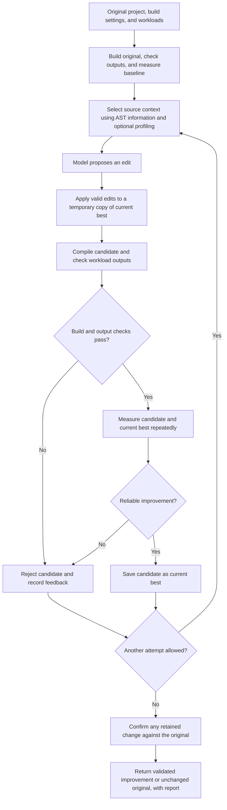
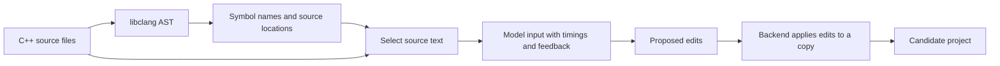

# C++ Optimize Assistant

An AI-assisted C/C++ optimization workbench that proposes source changes, checks program behavior, and measures performance before accepting an improvement.

**Performance highlight:** about **70% average execution-time reduction across 22 custom optimization benchmarks** in a local Apple M4 evaluation against a Clang `-O3` baseline. This is a coarse figure rounded to the nearest ten percentage points; the average includes unchanged cases. Results are specific to those workloads and are not a general guarantee or an LLVM-suite score.

Upload a source file or ZIP project, define representative inputs, and get back the original project structure with a source diff and measurement report. The application runs locally; selected source context is sent to Groq only when AI optimization is enabled.

**Start here:** [Run locally](#run-locally) · [Configure a project](#configure-a-project) · [Architecture walkthrough](#architecture-walkthrough) · [Benchmarking](#benchmarking)

## What it does

- **Preserves projects:** applies focused edits to existing files instead of reconstructing a combined C++ file.
- **Checks behavior:** compares stdout, stderr, and declared output files against the original and any supplied expectations.
- **Measures improvements:** uses warmups, repeated runs, alternating execution order, and a statistical acceptance threshold.
- **Understands source structure:** uses libclang AST information to select relevant functions and declarations, including excerpts from larger files.
- **Profiles workloads:** optionally collects Callgrind instruction counts to help locate expensive code.
- **Keeps execution separate:** supports restricted Docker workers or explicit native execution for trusted code.
- **Explains the result:** shows progress, proposal history, rejected changes, timing comparisons, and downloadable source diffs.

Three modes are available: **Optimize and verify**, **Benchmark only**, and **Compile only**. Benchmark and compile modes do not call the model; compile-only mode never executes the program.

## How it works



This chart shows the optimization pipeline itself, after a request has been scheduled. An unusable original build/baseline stops the job before a model call. Invalid model responses or edits are rejected too. If no change was retained, the original is returned; if final confirmation fails, the retained change is discarded. Compile-only and benchmark-only modes skip the proposal loop.

The backend controls the search and acceptance rules. The model proposes changes through a strict JSON schema; it cannot execute arbitrary tools or declare its own changes correct. Later attempts can use earlier compiler errors and validation feedback.

Clang compiles source through its normal AST → LLVM IR → machine-code pipeline. Python's libclang analysis supplies source context; the application does not transform LLVM IR or train the model.

## Technology stack

| Component | Technology | Responsibility |
|---|---|---|
| Frontend | React, Vite | Uploads, configuration, progress, results, and downloads |
| API | Python, FastAPI, Uvicorn | Request handling and local application hosting |
| Validation | Pydantic | Typed workload/build configuration and model responses |
| Job management | Python executor, local JSON state | Sequential execution, cancellation, and saved status |
| Source analysis | libclang | AST symbols, source locations, and function ranges |
| Build system | Clang/Clang++, CMake, Ninja or Make | Optimized C/C++ builds and multi-file targets |
| Profiling | Valgrind Callgrind | Instruction-count hotspots, separate from runtime measurement |
| Model | Groq-hosted `openai/gpt-oss-120b` | Focused optimization proposals |
| Isolation | Docker; optional Colima on macOS | Restricted local compilation and execution environments |
| Development | uv, pytest, Ruff, ESLint, GitHub Actions | Dependencies, regression tests, linting, and CI |

## Run locally

Requirements: Python 3.11+, [uv](https://docs.astral.sh/uv/), Node 22.12+ or a compatible newer version, and a running Docker-compatible engine. Linux and macOS are supported.

### Backend

```sh
uv sync --frozen
cp .env.example .env
docker build -f Dockerfile.runner -t cpp-optimizer-runner:local .
uv run uvicorn main:app --host 127.0.0.1 --port 8000
```

If you already have an `.env`, keep it and add missing settings instead of overwriting it. Add `GROQ_API_KEY` to enable AI optimization. Keep the provider account on its Free plan if you want no API charges; the application cannot control account billing settings.

### Frontend

In a second terminal:

```sh
cd frontend
npm ci
npm run dev
```

Open <http://localhost:5173>. Vite forwards `/api` requests to the local backend. The API reference is available at <http://localhost:8000/docs>.

For a single-server setup, run `npm run build` inside `frontend`, then restart the API. FastAPI will serve the built interface at <http://localhost:8000>.

### Docker on macOS

Colima provides a free local Docker runtime:

```sh
brew install colima docker
colima start --profile cpp-optimizer --cpu 2 --memory 3 --vm-type vz --activate=false
export DOCKER_CONTEXT=colima-cpp-optimizer
```

Then build the image and start the backend as above. You can also set `DOCKER_CONTEXT=colima-cpp-optimizer` in `.env`. Stop the dedicated VM when unused with `colima stop --profile cpp-optimizer`.

### Native execution

For your own trusted projects, set `OPTIMIZER_RUNNER=native` in `.env`. Install Clang; CMake projects also require CMake and Ninja or Make. On macOS, the Xcode command-line tools supply the native compiler. Install optional native AST bindings with `uv sync --extra ast`.

Native execution is not sandboxed. Docker is the default: its workers have no network access, an unprivileged user, read-only input mounts, and bounded resources. The model API key is not passed to execution workers.

## Configure a project

Upload one `.cpp`, `.cc`, `.cxx`, or `.c` file, or a ZIP containing sources, headers, and input data. The upload limit is 20 MiB. Include an `optimizer.json` at the project root to describe the build and workloads; UI options override manifest settings.

```json
{
  "build": "simple",
  "standard": "c++17",
  "sources": ["src/main.cpp", "src/algorithm.cpp"],
  "include_dirs": ["include"],
  "editable_files": ["src/algorithm.cpp"],
  "cases": [
    {"name": "edge", "args": ["0"], "expected_stdout": "0\n", "benchmark": false},
    {"name": "large", "args": ["1000000"], "stdin": ""}
  ],
  "attempts": 3,
  "repeats": 7,
  "min_improvement": 0.03,
  "profile": true
}
```

The simple builder compiles translation units separately with `-O3` and links them. For CMake projects, set `build` to `cmake`, provide `cmake_target`, and specify `executable` relative to the generated build directory. Dependencies must be available in the runner; execution containers cannot download them.

Workloads should produce deterministic results or checksums. Output comparison is exact, so printed timing logs and uncontrolled random output are unsuitable. Use `benchmark: false` for quick correctness checks and longer inputs for timing. Every execution starts with fresh fixtures. Passing supplied workloads is not a proof of equivalence for all possible inputs.

Try [the sum example](examples/sum) or [the multi-file CMake example](examples/cmake). To run a project without the UI:

```sh
uv run python cli.py examples/sum --mode benchmark --output sum-baseline.zip
```

## Benchmarking

The repository includes two separate collections:

- **22 custom optimization exercises:** copying, allocations, containers, search, sorting, matrices, strings, and arithmetic. Each has an immutable driver, independent small-input correctness checks, and two timed workloads.
- **Five pinned LLVM test-suite programs:** arrays, matrices, lists, sieve, and heapsort. The [LLVM adapter](benchmarks/llvm/README.md) verifies source hashes and upstream reference outputs. It protects workload drivers from edits and reports this subset separately from the custom suite.

Run all custom baselines without model calls:

```sh
uv run python benchmark_suite.py --mode benchmark --runner native --all --output benchmark-results/baselines
```

Optimize one unfinished benchmark at a time to manage free-tier limits:

```sh
uv run python benchmark_suite.py --mode optimize --runner native --next --output benchmark-results/optimized
```

Repeat the command to resume. Completed cases are skipped; provider-limit failures are saved as deferred. The suite defaults to one model attempt per benchmark. Use `--suite llvm` and a separate output directory for the LLVM subset, or `--runner docker` for isolated execution.

Performance reports use the arithmetic mean of per-benchmark runtime reductions. Each benchmark's runtime is the sum of its timed-workload medians; unchanged results contribute zero improvement. Both versions use the same build settings. Compilation and fixture preparation are excluded from timing, while process startup and program I/O are included. Keep the machine idle and avoid concurrent benchmark runs.

Personal reports, local validation notes, and exported snapshots stay in ignored directories. Benchmark sources, reference manifests, and automated tests remain version-controlled so others can run their own evaluations.

## Model configuration

Defaults in [.env.example](.env.example): `openai/gpt-oss-120b`, medium reasoning, temperature `0.2`, top-p `1`, a `2048`-token completion cap, and strict JSON output. The completion cap includes reasoning tokens. Requests do not stream or use hidden SDK retries.

Context is bounded and can include AST-selected source excerpts, optional profiling information, and recent failure feedback. Truncated responses and invalid patches are rejected. Jobs stop after two unsuccessful proposals, and quota failures never trigger a paid-provider fallback. Compile and benchmark modes work without a model key.

## Architecture walkthrough

Follow one example through the application: a user uploads a C++ project that reads numbers from a file, counts matches for a target number, and prints the count.

### 1. From a browser click to backend code

Selecting a file stores that selection in the browser. Clicking **Find improvements** sends the project and configuration to `POST /api/jobs`.

```text
React → HTTP request → Uvicorn → FastAPI route → backend Python code
```

- **React** manages the interface and user actions.
- **Vite** serves the frontend during development. Our proxy configuration forwards `/api` requests from port 5173 to the backend on port 8000.
- **Uvicorn** is the HTTP server listening on port 8000.
- **FastAPI** matches a request to a route and calls its Python handler.

When FastAPI serves the built frontend on port 8000, the page and API share one server, so the Vite proxy is unnecessary. The backend validates the upload, prepares a project directory, creates a job, and returns the job ID. React then polls `GET /api/jobs/{id}` roughly every 1.2 seconds to display progress. Cancellation and report downloads use separate API routes.

### 2. Jobs, configurations, workloads, proposals, and candidates

| Term | Meaning |
|---|---|
| **Job** | One submitted request to compile, benchmark, or optimize a project |
| **Configuration** | Instructions for building and evaluating that project |
| **Workload** | One particular execution: arguments, stdin, expected output, and any output files to check |
| **Proposal** | Source edits suggested by the model |
| **Candidate** | A complete project copy with a proposal's edits applied |

One job can contain many source files and several workloads. Submitting the same project twice creates two jobs. A job is not one source file or one model call.

```text
Job A
├── Uploaded project
├── Build configuration and workloads
├── Status, progress, and cancellation flag
└── Optimization attempts
    ├── Candidate 1
    ├── Candidate 2
    └── Candidate 3
```

The [job queue](jobs.py) is a waiting list of work to execute. It processes one job at a time: while Job A runs, Job B waits. This keeps HTTP requests responsive and reduces interference between benchmarks. The queue stores status locally as JSON; it does not require Redis or a database. Interrupted browser jobs are marked failed after a server restart. The separate benchmark-suite CLI can resume between completed benchmarks.

### 3. What configuration and workloads look like

Imagine this uploaded project:

```text
main.cpp
data/
  small.txt
  large.txt
optimizer.json
```

Its program accepts an input filename and a number to search for:

```sh
./program data/small.txt 42
```

If the small input contains three occurrences of `42`, its manifest could be:

```json
{
  "build": "simple",
  "sources": ["main.cpp"],
  "editable_files": ["main.cpp"],
  "attempts": 3,
  "repeats": 7,
  "cases": [
    {
      "name": "correctness-check",
      "args": ["data/small.txt", "42"],
      "expected_stdout": "3\n",
      "benchmark": false
    },
    {
      "name": "large-input",
      "args": ["data/large.txt", "42"],
      "benchmark": true
    }
  ]
}
```

`sources` identifies what to compile; `editable_files` limits where edits may occur. `attempts` permits up to three proposals, whereas `repeats` requests seven timed executions for each timed workload. The first case checks an expected answer without contributing to the timing comparison. The second measures a larger input, whose output is still compared against the original program.

[schemas.py](schemas.py) defines the rules for these inputs using Pydantic. For example, the schema says attempts must be an integer between one and five; the actual configuration supplies the value three. The schema is the definition of a valid configuration, not the user's configuration itself.

### 4. A proposal becomes a candidate project

Suppose the original program contains a read-only helper that takes a vector by value:

```cpp
int countMatches(std::vector<int> values, int target) {
    int count = 0;
    for (int value : values)
        if (value == target) ++count;
    return count;
}
```

The model might propose eliminating the vector copy:

```json
{
  "explanation": "Avoid copying the vector because this function only reads it.",
  "edits": [
    {
      "path": "main.cpp",
      "old": "int countMatches(std::vector<int> values, int target)",
      "new": "int countMatches(const std::vector<int>& values, int target)"
    }
  ]
}
```

That JSON is a proposal. The [pipeline](pipeline.py) creates a temporary copy of the current best project and applies the exact-match replacement. The complete edited project is the candidate:

```text
Original project                 Candidate project
├── main.cpp                     ├── main.cpp — proposed edit applied
└── data/                        └── data/ — unchanged
    ├── small.txt                    ├── small.txt
    └── large.txt                    └── large.txt
```

The files remain separate; the application does not concatenate them into one source file. The runner receives access to the whole candidate directory, along with the current best version and evaluation settings. A compilation failure, output mismatch, or insufficient speedup rejects the candidate without changing the saved best project.

### 5. The runner, worker, Docker image, and container

The [runner](runner.py) launches the execution environment. The [worker](worker.py) runs inside it and performs compilation, output checks, measurements, and optional profiling. This execution worker is distinct from the job queue's background thread, which coordinates the job on the host.

**Every project reuses the same toolchain image. Projects and candidates do not each create an image.**

| Item | Contents | Lifetime |
|---|---|---|
| **Docker image** | Prepared Linux environment with Python, compilers, build tools, and profiling tools | Stored locally and reused across evaluations |
| **Docker container** | A running instance of that image with access to a particular project | Temporary; removed after evaluation during normal cleanup |
| **Project/candidate files** | Uploaded sources, data, and proposed edits | Separate files supplied to the worker at runtime |
| **Job reports** | Status, source artifacts, diffs, and measurements | Saved locally under the job-retention policy |

During setup, `docker build` reads [Dockerfile.runner](Dockerfile.runner) and installs the image's Linux dependencies. It does not automatically copy the dependencies installed on the Mac. For each evaluation, the runner starts a container, mounts read-only copies of the inputs and worker code, and launches Python inside it. The worker copies inputs into its temporary working area, compiles the program, runs the workloads, and returns structured results.

On macOS, the layers are:

```text
Mac
└── Colima Linux virtual machine
    └── Docker engine
        └── Temporary execution container
            └── Python worker
                └── Compiler and C++ executable
```

The image is stored by Docker inside Colima's VM disk, which lives on the Mac. Stopping Colima leaves that disk and its images intact. The backend calls Groq outside the container, so model requests can use the network while the execution container has no network access. Native mode runs the worker directly on the host and omits the VM/container layers.

**You do not need to delete an image after each project.** The runner uses `docker run --rm` and a final container-cleanup step. Old image versions or build cache can accumulate when rebuilding the toolchain, and an abrupt host/daemon failure can leave containers behind; these are separate from normal project submissions. With the engine running and the appropriate context selected, inspect storage without deleting anything:

```sh
docker image ls
docker ps -a
docker system df
```

### 6. Compilation, linking, and CMake

Imagine a project with `main.cpp`, `math.cpp`, and `math.hpp`. The header declares `calculate()`, the math source defines it, and the main source calls it. A translation unit is approximately one source file after preprocessing, including its included headers.

A simplified build is:

```sh
clang++ -O3 -c main.cpp -o main.o
clang++ -O3 -c math.cpp -o math.o
clang++ -O3 main.o math.o -o program
```

The first two commands create object files containing compiled code. The linker combines them, resolves references such as the call to `calculate()`, and creates the executable. Headers normally participate through inclusion rather than being built as independent executables.

In simple mode, the worker assembles these commands. In CMake mode, the project describes a target—such as an executable named `app`—and its sources, libraries, and flags. CMake generates instructions for Ninja or Make, which run the configured compiler and linker. The worker requests that target and then executes the configured output program.

### 7. How the AST turns into model context

[analyze.py](analyze.py) uses libclang to walk an AST and retain a small symbol index. A function entry can look like:

```json
{
  "name": "countMatches(std::vector<int>, int)",
  "kind": "FUNCTION_DECL",
  "file": "main.cpp",
  "line": 12,
  "end_line": 17,
  "definition": true
}
```

[context.py](context.py) uses those source locations to select actual C++ text. The model receives a JSON payload like this simplified example, not the full AST tree:

```json
{
  "sources": {
    "main.cpp": "int countMatches(std::vector<int> values, int target) {\n    int count = 0;\n    for (int value : values)\n        if (value == target) ++count;\n    return count;\n}"
  },
  "source_windows": {
    "main.cpp": {"complete": false, "ranges": [[12, 17]]}
  },
  "editable_files": ["main.cpp"],
  "benchmarks": {
    "large-input": {"median_seconds": 0.42}
  },
  "profile": {"available": false},
  "history": []
}
```

The full payload can also include symbol information, omitted filenames, protected-driver instructions, profiling text, and recent failure feedback. Exact source excerpts may be marked with line-range annotations so the model can distinguish a complete file from a partial view.

Selection currently uses straightforward heuristics:

1. Prioritize files the model may edit, then filenames mentioned in available profiling output.
2. Include a complete file if it fits the remaining source budget.
3. For larger files, use AST function ranges, prioritizing names mentioned in profiling output.
4. Include nearby declarations and referenced helpers within the remaining space; this is not a complete dependency graph.
5. Rotate through other functions on later attempts.
6. Fall back to bounded line windows when useful AST ranges are unavailable.

The source-text budget is approximately 8 KB. Source discovery currently omits individual files larger than 512,000 bytes. Without profiling, selection relies more on source order and function locations. Missing context can lead to incorrect proposals, which must still pass compilation and workload checks.



### 8. Profiling, validation, and timing

The AST describes code structure. Callgrind profiling estimates where computational work occurs using instruction counts. Benchmarking measures elapsed execution time. They answer different questions, and profiling runs separately because instrumentation adds overhead.

Before a candidate can be accepted, it must compile, exit successfully, and match expected/original outputs for all supplied cases. Each execution receives fresh fixtures. The worker then measures repeated runs with a monotonic clock, alternates baseline/candidate order, and checks whether the improvement clears the configured threshold beyond observed noise. Very short baseline workloads under 5 ms cannot produce an accepted optimization; prefer representative workloads lasting at least 100 ms.

The original, current best, and candidate remain separate project copies. Rejected candidates never become the saved best. A retained improvement receives a final comparison against the original; a failed confirmation restores the original download.

The model proposes, the worker measures, and the pipeline decides. Model weights are not trained or updated during this process, and there is no autonomous agent framework controlling execution.

## Development

```sh
uv run ruff check .
uv run pytest -q
TEST_DOCKER=1 uv run pytest -q tests/test_docker.py tests/test_worker.py -k docker
cd frontend
npm run lint
npm run build
```

Docker tests require the built image and a running engine. GitHub Actions verifies the backend, a pinned LLVM workload, container execution, and the frontend build without live model calls.

Useful entry points: [API](main.py), [job queue](jobs.py), [optimization pipeline](pipeline.py), [execution runner](runner.py), [worker](worker.py), [AST indexing](analyze.py), [context selection](context.py), and [model integration](feedback.py).

This project targets local use with a single API instance. Public multi-user hosting, arbitrary build-system integration, and automatic discovery of project test frameworks are outside the current scope.
