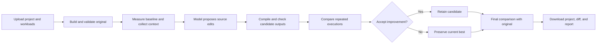

# C++ Optimize Assistant

An AI-assisted C/C++ optimization workbench that proposes source changes, checks program behavior, and measures performance before accepting an improvement.

**Performance highlight:** about **70% average execution-time reduction across 22 custom optimization benchmarks** in a local Apple M4 evaluation against a Clang `-O3` baseline. This is a coarse figure rounded to the nearest ten percentage points; the average includes unchanged cases. Results are specific to those workloads and are not a general guarantee or an LLVM-suite score.

Upload a source file or ZIP project, define representative inputs, and get back the original project structure with a source diff and measurement report. The application runs locally; selected source context is sent to Groq only when AI optimization is enabled.

## What it does

- **Preserves projects:** applies focused edits to existing files instead of reconstructing a combined C++ file.
- **Checks behavior:** compares stdout, stderr, and declared output files against the original and any supplied expectations.
- **Measures improvements:** uses warmups, repeated runs, alternating execution order, and a statistical acceptance threshold.
- **Understands source structure:** uses libclang AST information to select relevant functions and declarations, including excerpts from larger files.
- **Profiles workloads:** optionally collects Callgrind instruction counts to help locate expensive code.
- **Keeps execution separate:** supports restricted Docker workers or explicit native execution for trusted code.
- **Explains the result:** shows progress, proposal history, rejected changes, timing comparisons, and downloadable source diffs.

Three modes are available: **Optimize and verify**, **Benchmark only**, and **Compile only**. Benchmark and compile modes do not call the model; compile-only mode never executes the program.

## How it works



The backend controls the search and acceptance rules. The model proposes changes through a strict JSON schema; it cannot execute arbitrary tools or declare its own changes correct. Later attempts can use earlier compiler errors and validation feedback.

Clang compiles source through its normal AST → LLVM IR → machine-code pipeline. Python's libclang analysis supplies source context; the application does not transform LLVM IR or train the model.

## Technology stack

| Component | Technology | Responsibility |
|---|---|---|
| Frontend | React, Vite | Uploads, configuration, progress, results, and downloads |
| API | Python, FastAPI, Uvicorn | Request handling and local application hosting |
| Validation | Pydantic | Typed workload/build configuration and model responses |
| Job management | Python executor, local JSON state | Sequential execution, cancellation, and saved status |
| Source analysis | libclang | AST symbols, source locations, and function ranges |
| Build system | Clang/Clang++, CMake, Ninja or Make | Optimized C/C++ builds and multi-file targets |
| Profiling | Valgrind Callgrind | Instruction-count hotspots, separate from runtime measurement |
| Model | Groq-hosted `openai/gpt-oss-120b` | Focused optimization proposals |
| Isolation | Docker; optional Colima on macOS | Restricted local compilation and execution environments |
| Development | uv, pytest, Ruff, ESLint, GitHub Actions | Dependencies, regression tests, linting, and CI |

## Run locally

Requirements: Python 3.11+, [uv](https://docs.astral.sh/uv/), Node 22.12+ or a compatible newer version, and a running Docker-compatible engine. Linux and macOS are supported.

### Backend

```sh
uv sync --frozen
cp .env.example .env
docker build -f Dockerfile.runner -t cpp-optimizer-runner:local .
uv run uvicorn main:app --host 127.0.0.1 --port 8000
```

If you already have an `.env`, keep it and add missing settings instead of overwriting it. Add `GROQ_API_KEY` to enable AI optimization. Keep the provider account on its Free plan if you want no API charges; the application cannot control account billing settings.

### Frontend

In a second terminal:

```sh
cd frontend
npm ci
npm run dev
```

Open <http://localhost:5173>. Vite forwards `/api` requests to the local backend. The API reference is available at <http://localhost:8000/docs>.

For a single-server setup, run `npm run build` inside `frontend`, then restart the API. FastAPI will serve the built interface at <http://localhost:8000>.

### Docker on macOS

Colima provides a free local Docker runtime:

```sh
brew install colima docker
colima start --profile cpp-optimizer --cpu 2 --memory 3 --vm-type vz --activate=false
export DOCKER_CONTEXT=colima-cpp-optimizer
```

Then build the image and start the backend as above. You can also set `DOCKER_CONTEXT=colima-cpp-optimizer` in `.env`. Stop the dedicated VM when unused with `colima stop --profile cpp-optimizer`.

### Native execution

For your own trusted projects, set `OPTIMIZER_RUNNER=native` in `.env`. Install Clang; CMake projects also require CMake and Ninja or Make. On macOS, the Xcode command-line tools supply the native compiler. Install optional native AST bindings with `uv sync --extra ast`.

Native execution is not sandboxed. Docker is the default: its workers have no network access, an unprivileged user, read-only input mounts, and bounded resources. The model API key is not passed to execution workers.

## Configure a project

Upload one `.cpp`, `.cc`, `.cxx`, or `.c` file, or a ZIP containing sources, headers, and input data. The upload limit is 20 MiB. Include an `optimizer.json` at the project root to describe the build and workloads; UI options override manifest settings.

```json
{
  "build": "simple",
  "standard": "c++17",
  "sources": ["src/main.cpp", "src/algorithm.cpp"],
  "include_dirs": ["include"],
  "editable_files": ["src/algorithm.cpp"],
  "cases": [
    {"name": "edge", "args": ["0"], "expected_stdout": "0\n", "benchmark": false},
    {"name": "large", "args": ["1000000"], "stdin": ""}
  ],
  "attempts": 3,
  "repeats": 7,
  "min_improvement": 0.03,
  "profile": true
}
```

The simple builder compiles translation units separately with `-O3` and links them. For CMake projects, set `build` to `cmake`, provide `cmake_target`, and specify `executable` relative to the generated build directory. Dependencies must be available in the runner; execution containers cannot download them.

Workloads should produce deterministic results or checksums. Output comparison is exact, so printed timing logs and uncontrolled random output are unsuitable. Use `benchmark: false` for quick correctness checks and longer inputs for timing. Every execution starts with fresh fixtures. Passing supplied workloads is not a proof of equivalence for all possible inputs.

Try [the sum example](examples/sum) or [the multi-file CMake example](examples/cmake). To run a project without the UI:

```sh
uv run python cli.py examples/sum --mode benchmark --output sum-baseline.zip
```

## Benchmarking

The repository includes two separate collections:

- **22 custom optimization exercises:** copying, allocations, containers, search, sorting, matrices, strings, and arithmetic. Each has an immutable driver, independent small-input correctness checks, and two timed workloads.
- **Five pinned LLVM test-suite programs:** arrays, matrices, lists, sieve, and heapsort. The [LLVM adapter](benchmarks/llvm/README.md) verifies source hashes and upstream reference outputs. It protects workload drivers from edits and reports this subset separately from the custom suite.

Run all custom baselines without model calls:

```sh
uv run python benchmark_suite.py --mode benchmark --runner native --all --output benchmark-results/baselines
```

Optimize one unfinished benchmark at a time to manage free-tier limits:

```sh
uv run python benchmark_suite.py --mode optimize --runner native --next --output benchmark-results/optimized
```

Repeat the command to resume. Completed cases are skipped; provider-limit failures are saved as deferred. The suite defaults to one model attempt per benchmark. Use `--suite llvm` and a separate output directory for the LLVM subset, or `--runner docker` for isolated execution.

Performance reports use the arithmetic mean of per-benchmark runtime reductions. Each benchmark's runtime is the sum of its timed-workload medians; unchanged results contribute zero improvement. Both versions use the same build settings. Compilation and fixture preparation are excluded from timing, while process startup and program I/O are included. Keep the machine idle and avoid concurrent benchmark runs.

Personal reports, local validation notes, and exported snapshots stay in ignored directories. Benchmark sources, reference manifests, and automated tests remain version-controlled so others can run their own evaluations.

## Model configuration

Defaults in [.env.example](.env.example): `openai/gpt-oss-120b`, medium reasoning, temperature `0.2`, top-p `1`, a `2048`-token completion cap, and strict JSON output. The completion cap includes reasoning tokens. Requests do not stream or use hidden SDK retries.

Context is bounded and can include AST-selected source excerpts, optional profiling information, and recent failure feedback. Truncated responses and invalid patches are rejected. Jobs stop after two unsuccessful proposals, and quota failures never trigger a paid-provider fallback. Compile and benchmark modes work without a model key.

## Development

```sh
uv run ruff check .
uv run pytest -q
TEST_DOCKER=1 uv run pytest -q tests/test_docker.py tests/test_worker.py -k docker
cd frontend
npm run lint
npm run build
```

Docker tests require the built image and a running engine. GitHub Actions verifies the backend, a pinned LLVM workload, container execution, and the frontend build without live model calls.

Useful entry points: [API](main.py), [job queue](jobs.py), [optimization pipeline](pipeline.py), [execution runner](runner.py), [worker](worker.py), [AST indexing](analyze.py), [context selection](context.py), and [model integration](feedback.py).

This project targets local use with a single API instance. Public multi-user hosting, arbitrary build-system integration, and automatic discovery of project test frameworks are outside the current scope.
